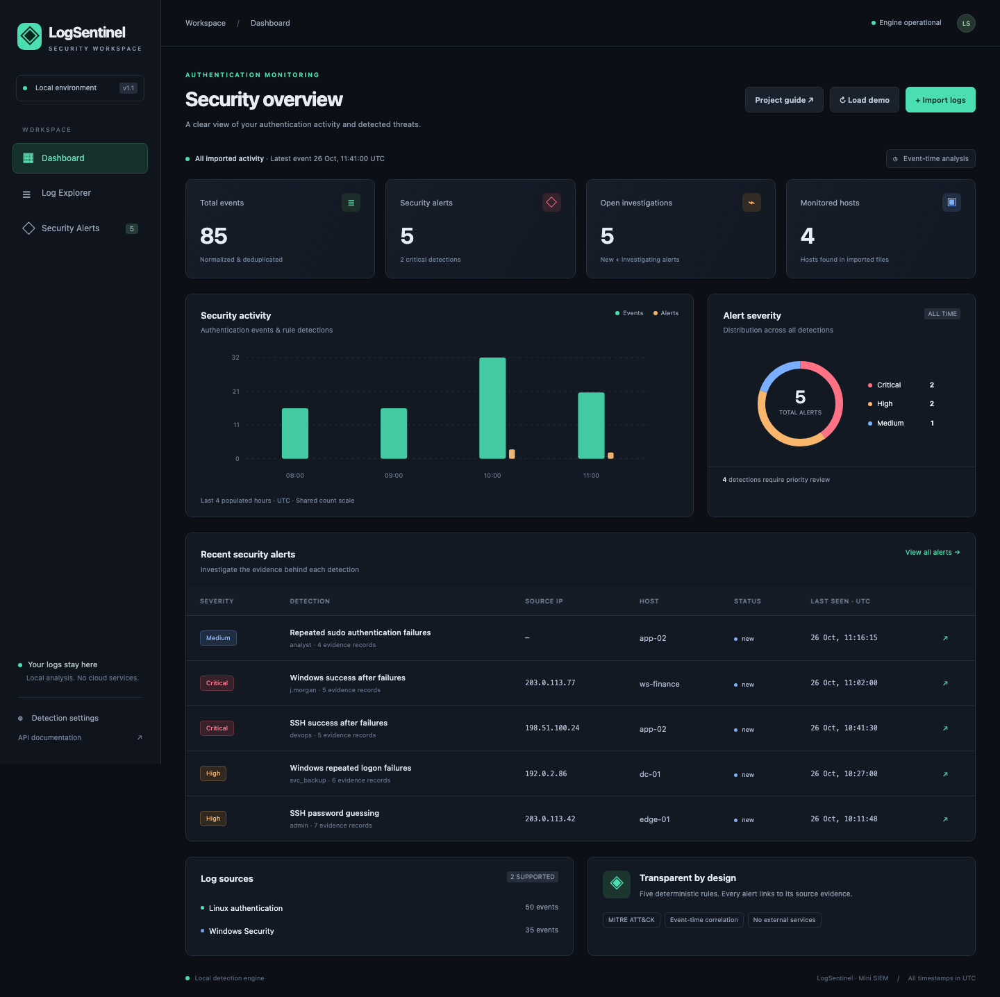
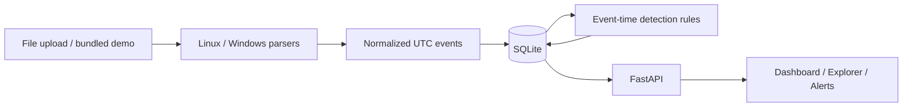

# LogSentinel

**Mini SIEM & Security Log Analyzer** — a local application that turns Linux and Windows authentication files into explainable security alerts.

Authentication records describe individual attempts. LogSentinel groups related records so a reviewer can see repeated failures and success-after-failure sequences. Each alert links to its matching identity, threshold, and original evidence.

The working demo produces **85 events and five alerts across four hosts**. Visitors can try three screens without a lab server. Technical readers can follow the same records through the code and tests.

Start with the [project guide](docs/INDEX.md), [How it works](docs/learning/HOW_IT_WORKS.md), or the [synthetic SSH case report](docs/reports/SSH_CASE_STUDY.md). The app also serves these guides locally through **Project guide**.

## Technical decisions

- **One service, local storage:** FastAPI serves the UI and API; SQLite avoids external infrastructure.
- **UTC event time:** correlation follows log timestamps, including files imported in a different order.
- **Explicit identity keys:** Windows domain and logon type prevent joins across unrelated authentication contexts.
- **Atomic replay:** new events and setting changes reanalyze stored data inside a transaction.
- **Transparent evidence:** SHA-256 keys prevent duplicate rows; they do not authenticate an imported source.

These choices are demonstrated in [architecture](docs/ARCHITECTURE.md), [five measured scenarios](docs/INDEX.md), and [executed validation](docs/VALIDATION.md).

## Quick start

```sh
docker compose up --build -d
```

Open **http://127.0.0.1:8765** and select **Load demo**. On a fresh database, the bundled synthetic files produce **85 events and 5 alerts** with default thresholds. Loading them again adds zero events and zero alerts. The demo is dated October 26, 2026; the dashboard displays imported event time, not the current date.



More real screenshots: [Log Explorer](docs/screenshots/log-explorer.png), [Security Alerts](docs/screenshots/security-alerts.png), [evidence timeline](docs/screenshots/alert-evidence.png), and [mobile layout](docs/screenshots/mobile.png).

The update also shows [Windows correlation context](docs/screenshots/windows-context.png) and the [offline walkthrough](docs/screenshots/how-it-works.png).

Docker Desktop is the recommended path for Windows and macOS. Linux requires Docker Engine and the Compose plugin. The image uses a standard Python base and does not require host log mounts or privileged access.

The host port defaults to 8765. To change it, copy `.env.example` to `.env` and set `LOGSENTINEL_PORT` before starting Compose. The container listens on port 8000 internally.

```sh
docker compose down       # Keep the named database volume
docker compose up -d     # Reuse stored events and investigation statuses
```

`docker compose down -v` **deletes the stored database**. Only use it when you intend to start fresh.

## Native installation

Python 3.11 or newer:

```sh
python3 -m venv .venv
source .venv/bin/activate
python -m pip install -r requirements.txt
python -m pip install --no-deps -e .
python -m uvicorn logsentinel.app:app --host 127.0.0.1 --port 8765
```

PowerShell: create the environment with `py -m venv .venv`, then use `.venv\Scripts\python.exe` for the Python commands. Docker Desktop is the validated Windows deployment approach by design; actual Windows execution is not claimed.

SQLite defaults to `data/logsentinel.db` relative to the working directory. Override it with `LOGSENTINEL_DB`. Start one application worker. The app initializes its own database and indexes.

## What you can do

- **Dashboard:** event and alert totals, severity distribution, hourly event/alert counts, source counts, and recent alerts.
- **Log Explorer:** literal search, exact source/IP/user/host/type filters, UTC date range filters, pagination, raw and normalized records.
- **Security Alerts:** actual evidence counts, matching identity, parameter snapshot, normal explanations, suggested analyst checks, limitations, MITRE tags, and investigation status.
- **Import:** UTF-8 files up to 5 MiB, with duplicate detection and per-record error reporting.
- **Settings:** configurable failure thresholds and correlation window; changes atomically reanalyze stored events.
- **Offline operation:** the UI uses local assets and makes no requests to third-party services. MITRE links open only when clicked.

## Detection rules

| Rule | Default | Correlation identity | Severity | ATT&CK interpretation |
|---|---|---|---|---|
| SSH password guessing | 5 failures / 300s | Host + IP + user | High | T1110.001 |
| SSH success after failures | 3 failures, then success / 300s | Host + IP + user | Critical | T1110.001, possible T1078 |
| Windows repeated failures | 5 failures / 300s | Host + IP + user + domain + logon type | High | T1110.001 |
| Windows success after failures | 3 failures, then success / 300s | Same Windows identity | Critical | T1110.001, possible T1078 |
| Repeated sudo failures | 3 PAM failures / 300s | Host + invoking user + terminal | Medium | T1110.001 |

These rules detect suspicious patterns, **not confirmed compromise**. Repeated sudo failures can be ordinary typing mistakes. ATT&CK mappings describe the observed behavior; they do not establish intent. See [MITRE password guessing](https://attack.mitre.org/techniques/T1110/001/) and [valid accounts](https://attack.mitre.org/techniques/T1078/).

Windows events without IP, target user, domain, or logon type remain searchable but cannot trigger these correlation rules. Sudo summaries remain searchable but do not count toward thresholds, avoiding double counting PAM details. Sudo records without a terminal are also excluded from correlation.

Explicit Windows channel/provider contradictions are rejected before normalization. Missing source fields retain simplified-export compatibility; accepted fields do not establish authenticity. See [the exact policy](docs/FORMATS.md).

Windows 4625 means logon failure, not necessarily a wrong password. Success after failures does not establish account takeover. These per-identity rules do not aggregate password spraying across accounts or distributed attempts across IPs.

## Architecture



A single Python service serves the API and static UI. SQLite provides local persistence, unique event identities, WAL journaling, and atomic ingestion/detection transactions. Vanilla JavaScript avoids a separate frontend toolchain. Parser, detection, storage, and HTTP layers are separate Python modules.

See [technical details](docs/ARCHITECTURE.md), [supported formats](docs/FORMATS.md), [demo guide](docs/DEMO.md), [security model](SECURITY.md), and the local [API reference](http://127.0.0.1:8765/docs).

## Supported files

- Linux `auth.log` / `secure` text: RFC3164 timestamps or ISO 8601 prefixes; SSH password/public-key/keyboard-interactive outcomes and sudo PAM authentication failures.
- Windows Security **4624 and 4625**: Event XML, an `Events` XML wrapper, JSON objects/arrays, or NDJSON with documented fields.
- Binary **EVTX is not supported**. Export to XML on Windows before import. UTF-16 and rendered/localized Windows message text are not supported; use UTF-8 named event fields.

For yearless Linux logs, select the actual year and timezone offset in the import dialog. Split files that span New Year or a daylight-saving offset change. Missing timezone information uses the explicit import offset; the default is UTC. Do not mix incompatible timestamp contexts in one import.

## Tests

```sh
python -m pip install -e '.[test]'
python -m pytest
```

Tests cover five attack scenarios, benign activity, correlation boundaries and identities, duplicates, malformed input, XML safety, date normalization, API filtering, settings, persistence, and local HTTP boundaries.

Optional real-browser checks:

```sh
python -m pip install -e '.[test,browser]'
python -m playwright install chromium
python tests/browser_smoke.py
```

The browser script starts an isolated local server and database. It verifies demo loading, all screens, raw evidence, filters, import, settings, investigation status, and mobile layout. See [validation results](docs/VALIDATION.md) for the actual tested environment and limitations.

Reproduce all documented examples with `python tools/verify_examples.py`. The tool uses a temporary database and compares five alert snapshots and 27 evidence records with the real engine.

The source documents are in `docs/`. Offline HTML is generated into the Python package:

```sh
python -m pip install -e '.[docs]'
python tools/build_guides.py
```

Regenerate guides after editing source documents or linked source files. Run the guide checks with `python -m pytest tests/test_guides.py`.

## Scope and limits

This is a small, local analysis tool. There is no authentication, multi-user access control, background log collection, real-time streaming, Sigma engine, AI integration, or network inspection. Defaults cap each import at 20,000 records and each database at 50,000 events. Imports and setting changes replay the stored dataset; use it for small datasets.

Raw logs and normalized identities are stored in plaintext SQLite. Keep the database private. Do not expose the service to a LAN or public network. See [SECURITY.md](SECURITY.md) before using sensitive logs.

## Portfolio description

> LogSentinel normalizes Linux SSH/sudo and Windows Security files into SQLite. Five configurable event-time rules generate evidence-linked alerts. The project includes source validation, duplicate-resistant ingestion, a local web interface, measured scenarios, and automated parser, correlation, API, and browser checks.

See [portfolio presentation](docs/PORTFOLIO.md) for a short Turkish narrative and a demonstration sequence. No personal experience, independent authorship, or production-use claim is implied.

## License

[MIT](LICENSE). Bundled logs are synthetic; addresses use private or documentation ranges.
