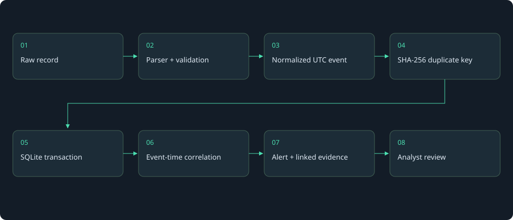

# LogEssential project guide

LogEssential makes authentication activity easier to investigate. Import Linux or Windows files, review five rule-based detections, and follow each alert to its source evidence.

The reproducible demo contains **85 events, four hosts, and five alerts**. Every result comes from the same parser and detection engine used for uploads.

## Try the working product

1. Follow the [README setup](../README.md).
2. Open the local workspace and select **Load demo**.
3. Open an alert and inspect a source record.

The application has a dashboard, a searchable log explorer, and an investigation view. This guide explains the implementation behind those screens.

## Follow one record through the system

Start with [How it works](learning/HOW_IT_WORKS.md). It maps actual Linux and Windows fields through UTC normalization, duplicate control, storage, correlation, and evidence review.

## Inspect the five scenarios

| Scenario | Measured demo result | Explanation |
|---|---|---|
| SSH password guessing | 7 failures → 1 high alert | [Scenario](detections/ssh_brute_force.md) |
| SSH success after failures | 4 failures + 1 success → 1 critical alert | [Scenario](detections/ssh_success_after_failures.md) |
| Windows repeated failures | 6 failures → 1 high alert | [Scenario](detections/windows_brute_force.md) |
| Windows success after failures | 4 failures + 1 success → 1 critical alert | [Scenario](detections/windows_success_after_failures.md) |
| Sudo authentication failures | 4 PAM records → 1 medium alert | [Scenario](detections/sudo_failures.md) |

Each scenario includes source records, an identity key, thresholds, a timeline, an engine-verified result, normal explanations, and analyst recommendations.

Read the [synthetic SSH case study](reports/SSH_CASE_STUDY.md) for a concise technical report. It separates verified observations, hypotheses, missing evidence, and suggested checks.

## Review the engineering choices

- [Architecture](ARCHITECTURE.md): separate modules, atomic transactions, replay, and stable identities.
- [Formats and source validation](FORMATS.md): supported inputs and what declared source fields can establish.
- [Security model](../SECURITY.md): loopback-only operation, plaintext data, and no authentication.
- [Current beta validation](VALIDATION_PUBLIC_BETA.md): tests actually executed, plus unverified environments.
- [Review follow-up](REVIEW_NOTES.md): previous findings compared with the current implementation.
- [Portfolio presentation](PORTFOLIO.md): a short English description and a Turkish presentation narrative.

This project demonstrates file-based analysis and explainable rule behavior. It does not measure production detection accuracy or establish its author's employment or learning history.

## Interactive investigation workspace · v1.2

Open **Detection Lab** in the app, or read [the learning workflow and research](LEARNING_WORKSPACE.md). [Current validation](VALIDATION_V1_2.md) separates v1.2 checks from earlier release results.
