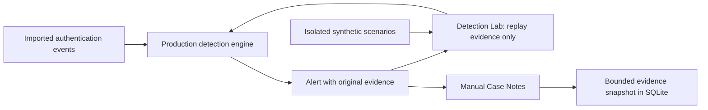

# Learning through real detections · v1.2

LogSentinel now connects an operational alert to an isolated experiment and a saved investigation. The learning material follows the implemented rules, including their blind spots.

## Evidence → experiment → reasoning



1. Open a security alert and inspect its matching identity and raw evidence.
2. Select **Replay this evidence in Detection Lab**.
3. Change a threshold or time window, then select **Run experiment**.
4. Move through events to see when the actual engine creates or updates alerts.
5. Return to the alert and save an observation, hypothesis and next step.
6. Open **Case Notes** to inspect or download the saved snapshot.

The lab never changes stored events, alerts, statuses, or rule settings. The settings dialog still changes the workspace and reanalyzes its complete dataset.

## Five isolated experiments

| Experiment | Default result | What it demonstrates |
|---|---|---|
| A login after failures | Two alerts | Five password failures trigger the failure rule; a later success triggers the sequence rule. Neither result proves compromise. |
| One second changes the result | One alert | Five failures span exactly 300 seconds. A 300-second window includes the first failure; 299 seconds excludes it. |
| Many accounts, no single match | No alerts | Each failure targets another user. Per-account grouping cannot detect cross-account spraying. |
| Failures that do not count | No alerts | Public-key failures are excluded from password-guessing rules. |
| Same account, different session type | No alerts | Type 10 failures and a type 3 success have different Windows identities. |

These are generated synthetic records, parsed by the production parsers. They are never imported by the lab. Objectives, optional hints and explanations are available beside the replay. There are no invented completion scores or personal learning claims.

## Replay contract

[lab.py](../logsentinel/lab.py) sorts evidence by normalized UTC timestamp and event ID. For every prefix, it calls the same [detect function](../logsentinel/detection.py) used for imported logs. The browser renders returned results; it does not implement another correlation engine.

The comparison uses workspace settings and experiment settings on the **same selected evidence**. Its counts do not describe the complete workspace unless that evidence happens to contain all records. It does not estimate precision, recall or false-positive rates.

An alert replay includes only that alert's current evidence IDs. Other identities, preceding successes and surrounding events are excluded. This subset can generate a different collection of alerts from a full workspace replay. Both results are valid only within their displayed scope.

Replay supports at most **200 evidence records**. Larger alerts return an explicit error; the API does not silently sample. Prefix replay costs more than one detection pass, so this bound keeps experiments small.

Equal timestamps never establish strict temporal precedence. Public-key failures, sudo summaries and incomplete identities remain ineligible under the same production policy.

## Manual Case Notes

Notes contain an assessment, observation, hypothesis and next step. Assessments are **undetermined**, **likely benign**, or **suspicious**. They are manual judgments, not detector verdicts.

Saving records the alert body, all evidence IDs, and up to **200 raw evidence records**. Larger alerts retain the first 199 records and the final record, preserving the closing success when present. Larger snapshots explicitly report the omitted raw-record count. The saved timestamp is the note-save time; event timestamps remain log time.

A separate SQLite table retains notes when rule reanalysis removes an alert. Each save replaces that alert's previous note and snapshot. The application provides no revision history, audit trail, authorship verification or multi-user conflict resolution. Saved notes do not automatically restore the live alert's workflow status.

JSON downloads contain raw logs and notes. Keep them private. Existing installations gain the table at startup with `CREATE TABLE IF NOT EXISTS`; event IDs, stored events and configuration are not rewritten.

## Honest dataset context

[provenance.py](../logsentinel/provenance.py) compares normalized event IDs against the bundled synthetic demo. Dashboard, event details, alert details and notes show exact matches as **bundled synthetic matches**. Other events are **unverified imports**.

This is a content match, not authenticated provenance. Renaming a demo file does not make it real. Naming another file “bundled synthetic demo” does not make its contents demo data. A nonmatching synthetic file remains an unverified import; the application cannot determine its real-world origin.

## Standalone experiment

[The export tool](../tools/export_learning_demo.py) produces a single HTML file with embedded synthetic records and 280 engine-measured combinations. Its controls select precomputed results; it contains no second detection engine and makes no runtime network calls. It varies failure-only thresholds together and keeps the success threshold at three.

```sh
python tools/export_learning_demo.py /path/to/logsentinel-experiment.html
```

## API

| Method | Endpoint | Behavior |
|---|---|---|
| GET | `/api/lab` | Scenario catalog and replay limit |
| POST | `/api/lab/replay` | Exactly one `scenario` or `alert_id`, plus a validated `settings` object |
| PUT | `/api/alerts/{id}/notebook` | Replace manual notes and refresh the evidence snapshot |
| GET | `/api/notebooks` | List saved notes, including inactive alerts |
| GET | `/api/notebooks/{id}` | Read a saved note and snapshot |

Existing local request boundaries, input validation, body limits and same-origin policy also apply to the new endpoints.

## Research and design decisions

Research date: **October 29, 2026**. Public first-party pages were inspected; no paid labs or authenticated training sessions were completed.

| Source | Observed approach | Adaptation in LogSentinel |
|---|---|---|
| [TryHackMe: Log Analysis with SIEM](https://tryhackme.com/room/loganalysiswithsiem) | Investigations start from log sources and concrete questions. | Start learning from an actual alert and its evidence. |
| [HTB Academy FAQ](https://academy.hackthebox.com/faq) | Short explanations, reproducible examples, hands-on checkpoints. | Small experiments with parameter changes and visible engine results. |
| [LetsDefend: simulated SIEM alerts](https://letsdefend.io/blog/how-we-generate-simulated-siem-alerts) | Alerts, aligned log context and analyst investigation playbooks. | Separate observation, hypothesis and the next evidence request. |
| [CyberDefenders: first CyberRange lab](https://help.cyberdefenders.org/en/articles/9978762-your-first-cyberrange-lab) | Evidence artifacts, optional hints and walkthroughs. | Preserve raw records and keep hints behind an explicit reveal. |

The strongest argument against a new lab is interface complexity. LogSentinel already had useful explanations and offline guides. A separate course catalog would duplicate them. The selected lab instead exposes the existing engine and can open directly from an operational alert.

Gamification, AI verdicts, invented accuracy scores and achievement stories were deliberately omitted. There is no evidence supporting those claims. The technical demonstration is the reproducible connection between source records, rule output and analyst reasoning.

Technical references: [MITRE T1110.001](https://attack.mitre.org/techniques/T1110/001/), [MITRE T1078](https://attack.mitre.org/techniques/T1078/), [Microsoft event 4625](https://learn.microsoft.com/en-us/previous-versions/windows/it-pro/windows-10/security/threat-protection/auditing/event-4625). Event 4625 describes failed logons; it does not establish that every failure was an incorrect password.

## Next priorities

1. Add a separately specified password-spraying rule with cross-account grouping and benign control datasets.
2. Expand Windows failure-code context while preserving event-ID compatibility and raw evidence.
3. Measure detections against reviewed, labeled datasets before publishing accuracy claims.
4. Add import-session history and immutable case revisions if repeated investigations need traceability.
5. Measure replay and ingestion performance before considering streaming or larger datasets.
