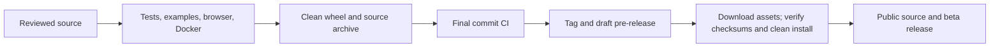

# LogEssential 1.2.0b1 release

LogEssential is the visible product name; it was previously called LogSentinel.
The `logsentinel` package, `LOGSENTINEL_DB`, Compose service, data path and GitHub repository keep their existing names.
This beta distributes source and local-use packages. It does not deploy a public service.

## Contents and limits

Detection Lab replays synthetic scenarios or at most 200 saved evidence records using the production engine.
It never changes workspace events, settings, alerts, statuses or notes.
Case Notes retain observations, hypotheses and next steps with bounded evidence snapshots.
Each save replaces the previous snapshot; notes are mutable and provide no immutable audit history.
Dataset context recognizes exact normalized demo matches; other imports remain unverified.

The service remains local and single-user, without authentication or authorization.
SQLite stores records and notes in plaintext. Protect the database and Docker volume.
There is no live collection, agent, binary EVTX import or production throughput guarantee.
Bind published Docker ports to `127.0.0.1`; do not add a public reverse proxy.

## Reproduce before tagging

1. Install `requirements.txt` and `.[test,browser,docs]` in a clean environment.
2. Run `python tools/build_guides.py` after editing guide inputs.
3. Run `python -m pytest` and `python tools/verify_examples.py`.
4. Run `python -m playwright install chromium` and `python tests/browser_smoke.py`.
5. Run `python tests/docker_smoke.py` against an available Docker daemon.
6. Build with `python -m build`; inspect both archives and install the wheel outside the checkout.
7. Run `python -I tools/release_smoke.py 1.2.0b1` with the clean environment's interpreter.
8. Audit the complete locked runtime requirements with current advisory data.
9. Push and require all checks on the exact final commit.
10. Tag `v1.2.0b1`; the release workflow creates a draft pre-release.
11. Download the actual assets and verify `SHA256SUMS` and a clean wheel install.
12. Publish the verified beta and confirm anonymous repository/asset access.

## Upgrade and rollback

1. Stop the local service before copying its database.
2. With Docker, run `docker compose down` without `-v` to retain the named volume.
3. Back up that volume or the native database, including a checkpointed SQLite copy.
4. Install the verified wheel using its accompanying requirements as constraints, or rebuild with `docker compose up -d --build`.
5. Confirm health version `1.2.0b1`, existing event counts, settings, alert statuses and saved notes.

Startup adds the `notebooks` table without changing existing event identities or reparsing records.
An actual v1.1.0-to-beta Docker upgrade preserved 85 synthetic events, settings and a saved alert status.
A new note survived the upgraded container's restart.

For rollback, stop the service and restore the matching pre-upgrade database backup with the previous code/image.
Keep a separate post-upgrade backup if newer notes must be retained.
Never run `docker compose down -v` on the user's working project as an upgrade step.

## Publication evidence

See [30 October validation](VALIDATION_PUBLIC_BETA.md) for local checks and their limits.
The exact final commit's CI and tag workflow are available under the repository's Actions tab.
The beta release carries the matching wheel, source archive, locked requirements, SBOM and SHA-256 checksums.
