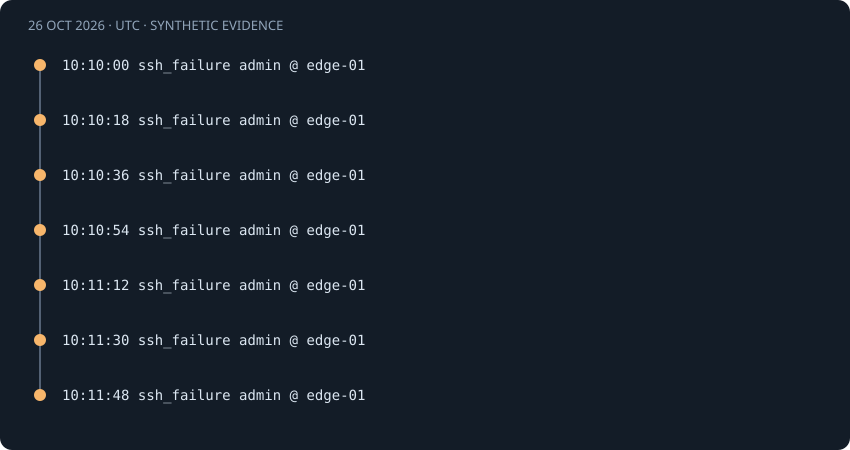

# SSH password guessing

[Project guide](../INDEX.md) · [How it works](../learning/HOW_IT_WORKS.md)

## Observed behavior

SSH exposes authentication outcomes that can reveal repeated attempts against one account. The parser accepts password and keyboard-interactive failures. Public-key failures remain searchable but do not count toward password guessing.

This is a **synthetic demo scenario**, not a real incident investigation. All timestamps below are October 26, 2026, in UTC.



## Actual source records

These are the records used by the bundled demo and the real detection engine.

<!-- evidence:start -->
```text
2026-10-26T10:10:00Z edge-01 sshd[5000]: Failed password for invalid user admin from 203.0.113.42 port 51000 ssh2
2026-10-26T10:10:18Z edge-01 sshd[5001]: Failed password for invalid user admin from 203.0.113.42 port 51001 ssh2
2026-10-26T10:10:36Z edge-01 sshd[5002]: Failed password for invalid user admin from 203.0.113.42 port 51002 ssh2
2026-10-26T10:10:54Z edge-01 sshd[5003]: Failed password for invalid user admin from 203.0.113.42 port 51003 ssh2
2026-10-26T10:11:12Z edge-01 sshd[5004]: Failed password for invalid user admin from 203.0.113.42 port 51004 ssh2
2026-10-26T10:11:30Z edge-01 sshd[5005]: Failed password for invalid user admin from 203.0.113.42 port 51005 ssh2
2026-10-26T10:11:48Z edge-01 sshd[5006]: Failed password for invalid user admin from 203.0.113.42 port 51006 ssh2
```
<!-- evidence:end -->

The raw method is password. Host, user, IP, PID, and source port come from the log line. The parser does not verify who controlled the source IP.

## Normalized fields and correlation identity

| Identity field | Effective matching value |
|---|---|
| `host` | `edge-01` |
| `source_ip` | `203.0.113.42` |
| `user` | `admin` |

Windows identities use case-folded host, account, and domain values. Linux account and host comparisons retain case. IPs normalize to canonical addresses. Only the fields listed in this scenario's identity form its correlation group.

The first record also carries this metadata:

| Metadata field | Value |
|---|---|
| `pid` | `5000` |
| `method` | `password` |
| `source_port` | `51000` |

See the [normalization guide](../learning/HOW_IT_WORKS.md) for source-field interpretation.

## Threshold and event-time window

The rule requires **5 failure records within 300 seconds**. The threshold is first reached at **10:11:12 UTC**. The same bounded episode later holds 7 evidence records. Each additional record does not create a separate alert.

The lower lookback boundary is inclusive. Events exactly 300 seconds apart remain eligible under the default window. At 301 seconds they may no longer form the same qualifying set. A success must be strictly later than its counted failures; an equal timestamp cannot prove ordering.

## Timeline and measured result

| Time · UTC | Normalized event | Event ID prefix |
|---|---|---|
| 10:10:00 | `ssh_failure` | `c2dc05fabcbe` |
| 10:10:18 | `ssh_failure` | `651d4536d32f` |
| 10:10:36 | `ssh_failure` | `cd9823eff5f1` |
| 10:10:54 | `ssh_failure` | `411bdfa2f0c9` |
| 10:11:12 | `ssh_failure` | `4de637a8bb80` |
| 10:11:30 | `ssh_failure` | `864be6cd3f70` |
| 10:11:48 | `ssh_failure` | `2fa09dd6d43f` |

The following snapshot comes from a fresh temporary database with default settings. Full IDs identify reproducible internal records; they do not authenticate their source.

<!-- result:start -->
```json
{
  "id": "c84d3c72e30c5b158ecf14f139618cfcd8d84a3673be7e6580b162a4f04359c3",
  "rule": "ssh_brute_force",
  "title": "SSH password guessing",
  "severity": "high",
  "first_seen": "2026-10-26T10:10:00.000000Z",
  "last_seen": "2026-10-26T10:11:48.000000Z",
  "evidence_count": 7,
  "failure_count": 7,
  "success_count": 0,
  "identity": {
    "host": "edge-01",
    "source_ip": "203.0.113.42",
    "user": "admin"
  },
  "parameters": {
    "threshold": 5,
    "window_seconds": 300
  }
}
```
<!-- result:end -->

The complete demo produces five alerts. This identity produces the single alert shown above. Severity is a fixed rule label, not a probability of compromise.

## Normal explanations

A mistyped password or stale automation credential can produce the same pattern.

## What the rule misses

A source rotating across accounts stays below each per-user counter. Multiple IPs attacking one account remain separate. This rule also misses attempts spread beyond the time window.

Across the SSH and Windows rules, password spraying across accounts and distributed attempts across IPs remain separate groups. A local sudo sequence uses terminal context instead of a network IP. These are deliberate coverage limits, not measured false-negative rates.

## Suggested analyst checks · not automated

1. Confirm the source IP and account are expected.
2. Review adjacent SSH outcomes and authentication configuration.
3. Record the remaining uncertainty before taking account or host action.

LogEssential automatically parses, deduplicates, correlates, and links evidence. It does not contact users, query account state, collect session commands, or perform containment.

## ATT&CK interpretation

Password guessing is the relevant behavioral hypothesis. Repetition alone cannot identify the operator or prove malicious intent. See [T1110.001](https://attack.mitre.org/techniques/T1110/001/) and the broader [ATT&CK technique context](https://attack.mitre.org/techniques/T1110/001/). The mapping describes a behavior to investigate.

## Reproduce without touching your working database

1. Install the project and test extra from the README.
2. Run `python tools/verify_examples.py` from the repository root.
3. Compare this file's result JSON with `docs/examples.json`.
4. Run `python -m pytest tests/test_examples.py tests/test_detection.py`.

The verification tool creates and removes its own temporary database. It validates every source record and the alert snapshot. In the browser, open this rule under **Security Alerts**, then inspect an evidence record.

Code: [parser](../../logsentinel/parsers.py), [correlation](../../logsentinel/detection.py), [storage](../../logsentinel/storage.py), [guidance](../../logsentinel/guidance.py).

Tests: [documented examples](../../tests/test_examples.py), [thresholds and identities](../../tests/test_detection.py), [API and evidence](../../tests/test_api.py).
