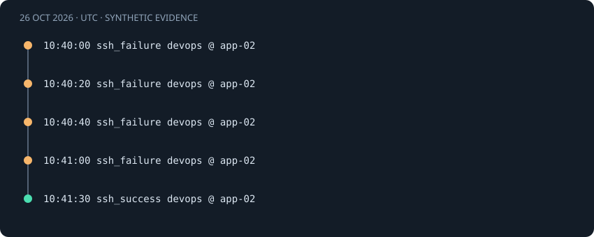

# SSH success after failures

[Project guide](../INDEX.md) · [How it works](../learning/HOW_IT_WORKS.md)

## Observed behavior

A successful SSH authentication follows several failures with the same host, IP, and account. I correlate the sequence to make a successful login visible for review. I do not label it a confirmed takeover.

This is a **synthetic demo scenario**, not a real incident investigation. All timestamps below are October 26, 2026, in UTC.



## Actual source records

These are the records used by the bundled demo and the real detection engine.

<!-- evidence:start -->
```text
2026-10-26T10:40:00Z app-02 sshd[6000]: Failed password for devops from 198.51.100.24 port 52000 ssh2
2026-10-26T10:40:20Z app-02 sshd[6001]: Failed password for devops from 198.51.100.24 port 52001 ssh2
2026-10-26T10:40:40Z app-02 sshd[6002]: Failed password for devops from 198.51.100.24 port 52002 ssh2
2026-10-26T10:41:00Z app-02 sshd[6003]: Failed password for devops from 198.51.100.24 port 52003 ssh2
2026-10-26T10:41:30Z app-02 sshd[6010]: Accepted password for devops from 198.51.100.24 port 52010 ssh2
```
<!-- evidence:end -->

The raw method is password. Host, user, IP, PID, and source port come from the log line. The parser does not verify who controlled the source IP.

## Normalized fields and correlation identity

| Identity field | Effective matching value |
|---|---|
| `host` | `app-02` |
| `source_ip` | `198.51.100.24` |
| `user` | `devops` |

Windows identities use case-folded host, account, and domain values. Linux account and host comparisons retain case. IPs normalize to canonical addresses. Only the fields listed in this scenario's identity form its correlation group.

The first record also carries this metadata:

| Metadata field | Value |
|---|---|
| `pid` | `6000` |
| `method` | `password` |
| `source_port` | `52000` |

See the [normalization guide](../learning/HOW_IT_WORKS.md) for source-field interpretation.

## Threshold and event-time window

The success rule requires at least **3 failures** strictly before a success within **300 seconds**. Here, 4 failures qualify. The independent failure rule requires **5 failures**. This sequence has only 4, so it does not generate that separate failure alert.

The lower lookback boundary is inclusive. Events exactly 300 seconds apart remain eligible under the default window. At 301 seconds they may no longer form the same qualifying set. A success must be strictly later than its counted failures; an equal timestamp cannot prove ordering.

## Timeline and measured result

| Time · UTC | Normalized event | Event ID prefix |
|---|---|---|
| 10:40:00 | `ssh_failure` | `3b9fef79c1d8` |
| 10:40:20 | `ssh_failure` | `8e1c7e7e3d38` |
| 10:40:40 | `ssh_failure` | `845d9ffa4346` |
| 10:41:00 | `ssh_failure` | `d0d9e69b1272` |
| 10:41:30 | `ssh_success` | `776fd8b70426` |

The following snapshot comes from a fresh temporary database with default settings. Full IDs identify reproducible internal records; they do not authenticate their source.

<!-- result:start -->
```json
{
  "id": "a93aea77b0912d5f3e91239bd39acaa60d9dbc9c4634d584f109dfcb57a57be5",
  "rule": "ssh_success_after_failures",
  "title": "SSH success after failures",
  "severity": "critical",
  "first_seen": "2026-10-26T10:40:00.000000Z",
  "last_seen": "2026-10-26T10:41:30.000000Z",
  "evidence_count": 5,
  "failure_count": 4,
  "success_count": 1,
  "identity": {
    "host": "app-02",
    "source_ip": "198.51.100.24",
    "user": "devops"
  },
  "parameters": {
    "threshold": 3,
    "window_seconds": 300
  }
}
```
<!-- result:end -->

The complete demo produces five alerts. This identity produces the single alert shown above. Severity is a fixed rule label, not a probability of compromise.

## Normal explanations

The legitimate user may have corrected a password or switched authentication methods.

## What the rule misses

Changing the IP, account, or destination host splits the sequence. Slow attempts can age out. The app does not collect commands or reconstruct an interactive session.

Across the SSH and Windows rules, password spraying across accounts and distributed attempts across IPs remain separate groups. A local sudo sequence uses terminal context instead of a network IP. These are deliberate coverage limits, not measured false-negative rates.

## Suggested analyst checks · not automated

1. Verify the login with the account owner and compare expected source addresses.
2. Review session activity in separately collected host logs.
3. Record the remaining uncertainty before taking account or host action.

LogSentinel automatically parses, deduplicates, correlates, and links evidence. It does not contact users, query account state, collect session commands, or perform containment.

## ATT&CK interpretation

T1110.001 describes the possible guessing phase. T1078 describes the possible misuse of a valid account. A successful authentication does not establish that misuse occurred. See [T1110.001](https://attack.mitre.org/techniques/T1110/001/) and [T1078](https://attack.mitre.org/techniques/T1078/). The mapping describes a behavior to investigate.

## Reproduce without touching your working database

1. Install the project and test extra from the README.
2. Run `python tools/verify_examples.py` from the repository root.
3. Compare this file's result JSON with `docs/examples.json`.
4. Run `python -m pytest tests/test_examples.py tests/test_detection.py`.

The verification tool creates and removes its own temporary database. It validates every source record and the alert snapshot. In the browser, open this rule under **Security Alerts**, then inspect an evidence record.

Code: [parser](../../logsentinel/parsers.py), [correlation](../../logsentinel/detection.py), [storage](../../logsentinel/storage.py), [guidance](../../logsentinel/guidance.py).

Tests: [documented examples](../../tests/test_examples.py), [thresholds and identities](../../tests/test_detection.py), [API and evidence](../../tests/test_api.py).
