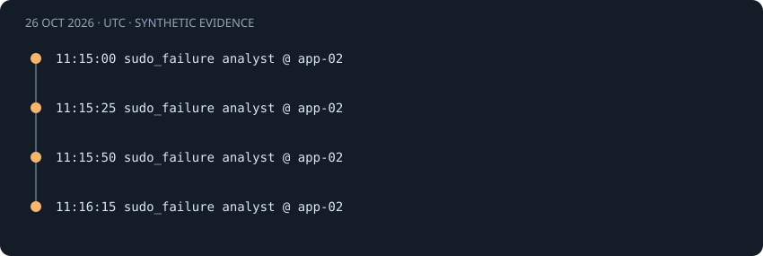

# Repeated sudo authentication failures

[Project guide](../INDEX.md) · [How it works](../learning/HOW_IT_WORKS.md)

## Observed behavior

Local sudo PAM failures can show repeated authentication attempts before privileged activity. I count detailed PAM records and retain the invoking user separately from the target account.

This is a **synthetic demo scenario**, not a real incident investigation. All timestamps below are October 26, 2026, in UTC.



## Actual source records

These are the records used by the bundled demo and the real detection engine.

<!-- evidence:start -->
```text
2026-10-26T11:15:00Z app-02 sudo[7000]: pam_unix(sudo:auth): authentication failure; logname=analyst uid=1001 euid=0 tty=/dev/pts/1 ruser=analyst rhost= user=root
2026-10-26T11:15:25Z app-02 sudo[7001]: pam_unix(sudo:auth): authentication failure; logname=analyst uid=1001 euid=0 tty=/dev/pts/1 ruser=analyst rhost= user=root
2026-10-26T11:15:50Z app-02 sudo[7002]: pam_unix(sudo:auth): authentication failure; logname=analyst uid=1001 euid=0 tty=/dev/pts/1 ruser=analyst rhost= user=root
2026-10-26T11:16:15Z app-02 sudo[7003]: pam_unix(sudo:auth): authentication failure; logname=analyst uid=1001 euid=0 tty=/dev/pts/1 ruser=analyst rhost= user=root
```
<!-- evidence:end -->

The invoking user is `analyst`; `user=root` is the PAM target. These records have no remote source IP. Four PAM records are counted, not an inferred number of password attempts.

## Normalized fields and correlation identity

| Identity field | Effective matching value |
|---|---|
| `host` | `app-02` |
| `user` | `analyst` |
| `terminal` | `/dev/pts/1` |

Windows identities use case-folded host, account, and domain values. Linux account and host comparisons retain case. IPs normalize to canonical addresses. Only the fields listed in this scenario's identity form its correlation group.

The first record also carries this metadata:

| Metadata field | Value |
|---|---|
| `pid` | `7000` |
| `target_user` | `root` |
| `tty` | `/dev/pts/1` |

See the [normalization guide](../learning/HOW_IT_WORKS.md) for source-field interpretation.

## Threshold and event-time window

The rule requires **3 failure records within 300 seconds**. The threshold is first reached at **11:15:50 UTC**. The same bounded episode later holds 4 evidence records. Each additional record does not create a separate alert.

The lower lookback boundary is inclusive. Events exactly 300 seconds apart remain eligible under the default window. At 301 seconds they may no longer form the same qualifying set. A success must be strictly later than its counted failures; an equal timestamp cannot prove ordering.

## Timeline and measured result

| Time · UTC | Normalized event | Event ID prefix |
|---|---|---|
| 11:15:00 | `sudo_failure` | `0ca9be86b0df` |
| 11:15:25 | `sudo_failure` | `807f116a1a93` |
| 11:15:50 | `sudo_failure` | `a72bd9a96b5e` |
| 11:16:15 | `sudo_failure` | `ff08baf07591` |

The following snapshot comes from a fresh temporary database with default settings. Full IDs identify reproducible internal records; they do not authenticate their source.

<!-- result:start -->
```json
{
  "id": "534b87a7da7d4e2289328d35bbfc5aa902aac433cf96dad27c0a9979c2d977c2",
  "rule": "sudo_failures",
  "title": "Repeated sudo authentication failures",
  "severity": "medium",
  "first_seen": "2026-10-26T11:15:00.000000Z",
  "last_seen": "2026-10-26T11:16:15.000000Z",
  "evidence_count": 4,
  "failure_count": 4,
  "success_count": 0,
  "identity": {
    "host": "app-02",
    "user": "analyst",
    "terminal": "/dev/pts/1"
  },
  "parameters": {
    "threshold": 3,
    "window_seconds": 300
  }
}
```
<!-- result:end -->

The complete demo produces five alerts. This identity produces the single alert shown above. Severity is a fixed rule label, not a probability of compromise.

## Normal explanations

The invoking user may have mistyped a password or misunderstood the sudo policy.

## What the rule misses

Different terminals or invoking users stay separate. Missing terminal/user prevents correlation. Aggregate summaries are not extra attempts. The app does not verify command execution or privilege escalation.

Across the SSH and Windows rules, password spraying across accounts and distributed attempts across IPs remain separate groups. A local sudo sequence uses terminal context instead of a network IP. These are deliberate coverage limits, not measured false-negative rates.

## Suggested analyst checks · not automated

1. Confirm the invoking user's activity and inspect the terminal context.
2. Review sudo policy and additional command/session logs if available.
3. Record the remaining uncertainty before taking account or host action.

LogSentinel automatically parses, deduplicates, correlates, and links evidence. It does not contact users, query account state, collect session commands, or perform containment.

## ATT&CK interpretation

T1110.001 is a cautious mapping for possible local password guessing. Four PAM failures do not prove intent or a successful privilege escalation. See [T1110.001](https://attack.mitre.org/techniques/T1110/001/) and the broader [ATT&CK technique context](https://attack.mitre.org/techniques/T1110/001/). The mapping describes a behavior to investigate.

## Reproduce without touching your working database

1. Install the project and test extra from the README.
2. Run `python tools/verify_examples.py` from the repository root.
3. Compare this file's result JSON with `docs/examples.json`.
4. Run `python -m pytest tests/test_examples.py tests/test_detection.py`.

The verification tool creates and removes its own temporary database. It validates every source record and the alert snapshot. In the browser, open this rule under **Security Alerts**, then inspect an evidence record.

Code: [parser](../../logsentinel/parsers.py), [correlation](../../logsentinel/detection.py), [storage](../../logsentinel/storage.py), [guidance](../../logsentinel/guidance.py).

Tests: [documented examples](../../tests/test_examples.py), [thresholds and identities](../../tests/test_detection.py), [API and evidence](../../tests/test_api.py).
