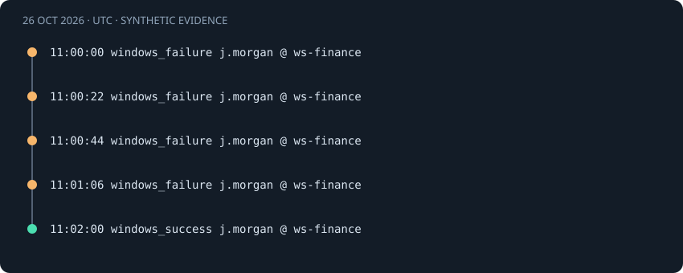

# Windows success after failures

[Project guide](../INDEX.md) · [How it works](../learning/HOW_IT_WORKS.md)

## Observed behavior

A 4624 session-creation event follows matching 4625 failures. I require the same domain and logon type as well as host, account, and IP. This prevents joining unrelated authentication contexts.

This is a **synthetic demo scenario**, not a real incident investigation. All timestamps below are October 26, 2026, in UTC.



## Actual source records

These are the records used by the bundled demo and the real detection engine.

<!-- evidence:start -->
```json
{"System": {"EventID": 4625, "TimeCreated": {"SystemTime": "2026-10-26T11:00:00Z"}, "Computer": "ws-finance", "EventRecordID": "11000", "Channel": "Security"}, "EventData": {"TargetUserName": "j.morgan", "TargetDomainName": "LAB", "IpAddress": "203.0.113.77", "LogonType": "10"}}
{"System": {"EventID": 4625, "TimeCreated": {"SystemTime": "2026-10-26T11:00:22Z"}, "Computer": "ws-finance", "EventRecordID": "11001", "Channel": "Security"}, "EventData": {"TargetUserName": "j.morgan", "TargetDomainName": "LAB", "IpAddress": "203.0.113.77", "LogonType": "10"}}
{"System": {"EventID": 4625, "TimeCreated": {"SystemTime": "2026-10-26T11:00:44Z"}, "Computer": "ws-finance", "EventRecordID": "11002", "Channel": "Security"}, "EventData": {"TargetUserName": "j.morgan", "TargetDomainName": "LAB", "IpAddress": "203.0.113.77", "LogonType": "10"}}
{"System": {"EventID": 4625, "TimeCreated": {"SystemTime": "2026-10-26T11:01:06Z"}, "Computer": "ws-finance", "EventRecordID": "11003", "Channel": "Security"}, "EventData": {"TargetUserName": "j.morgan", "TargetDomainName": "LAB", "IpAddress": "203.0.113.77", "LogonType": "10"}}
{"System": {"EventID": 4624, "TimeCreated": {"SystemTime": "2026-10-26T11:02:00Z"}, "Computer": "ws-finance", "EventRecordID": "11010", "Channel": "Security"}, "EventData": {"TargetUserName": "j.morgan", "TargetDomainName": "LAB", "IpAddress": "203.0.113.77", "LogonType": "10"}}
```
<!-- evidence:end -->

The actual demo exports omit Provider. Channel is Security. Missing source fields are accepted for compatibility, not authenticated. Explicit contradictions are rejected. The demo also omits Status/SubStatus, so the failure cause is unknown.

## Normalized fields and correlation identity

| Identity field | Effective matching value |
|---|---|
| `host` | `ws-finance` |
| `source_ip` | `203.0.113.77` |
| `user` | `j.morgan` |
| `domain` | `lab` |
| `logon_type` | `10` |

Windows identities use case-folded host, account, and domain values. Linux account and host comparisons retain case. IPs normalize to canonical addresses. Only the fields listed in this scenario's identity form its correlation group.

The first record also carries this metadata:

| Metadata field | Value |
|---|---|
| `event_id` | `4625` |
| `record_id` | `11000` |
| `channel` | `Security` |
| `domain` | `LAB` |
| `logon_type` | `10` |

See the [Microsoft 4625](https://learn.microsoft.com/en-us/previous-versions/windows/it-pro/windows-10/security/threat-protection/auditing/event-4625) and [Microsoft 4624](https://learn.microsoft.com/en-us/previous-versions/windows/it-pro/windows-10/security/threat-protection/auditing/event-4624) for source-field interpretation.

## Threshold and event-time window

The success rule requires at least **3 failures** strictly before a success within **300 seconds**. Here, 4 failures qualify. The independent failure rule requires **5 failures**. This sequence has only 4, so it does not generate that separate failure alert.

The lower lookback boundary is inclusive. Events exactly 300 seconds apart remain eligible under the default window. At 301 seconds they may no longer form the same qualifying set. A success must be strictly later than its counted failures; an equal timestamp cannot prove ordering.

## Timeline and measured result

| Time · UTC | Normalized event | Event ID prefix |
|---|---|---|
| 11:00:00 | `windows_failure` | `f5641a7f3e65` |
| 11:00:22 | `windows_failure` | `ce6faafeb216` |
| 11:00:44 | `windows_failure` | `77e98e5d8729` |
| 11:01:06 | `windows_failure` | `794f5ccea4d4` |
| 11:02:00 | `windows_success` | `a2724be1c259` |

The following snapshot comes from a fresh temporary database with default settings. Full IDs identify reproducible internal records; they do not authenticate their source.

<!-- result:start -->
```json
{
  "id": "2070f99ef53da925047caee35b8e87e78391f143cdaa4daae9dcbb4ed4cdd013",
  "rule": "windows_success_after_failures",
  "title": "Windows success after failures",
  "severity": "critical",
  "first_seen": "2026-10-26T11:00:00.000000Z",
  "last_seen": "2026-10-26T11:02:00.000000Z",
  "evidence_count": 5,
  "failure_count": 4,
  "success_count": 1,
  "identity": {
    "host": "ws-finance",
    "source_ip": "203.0.113.77",
    "user": "j.morgan",
    "domain": "lab",
    "logon_type": "10"
  },
  "parameters": {
    "threshold": 3,
    "window_seconds": 300
  }
}
```
<!-- result:end -->

The complete demo produces five alerts. This identity produces the single alert shown above. Severity is a fixed rule label, not a probability of compromise.

## Normal explanations

A user may recover from a typo, or an administrator may fix an account or service configuration.

## What the rule misses

An IP, domain, host, account, or logon-type change prevents the join. Slow or incomplete records can evade correlation. The rule does not establish session ownership or inspect post-login actions.

Across the SSH and Windows rules, password spraying across accounts and distributed attempts across IPs remain separate groups. A local sudo sequence uses terminal context instead of a network IP. These are deliberate coverage limits, not measured false-negative rates.

## Suggested analyst checks · not automated

1. Inspect raw failure codes and confirm the expected user, domain, and logon type.
2. Correlate session activity using additional host logs and confirm the login with its owner.
3. Record the remaining uncertainty before taking account or host action.

LogEssential automatically parses, deduplicates, correlates, and links evidence. It does not contact users, query account state, collect session commands, or perform containment.

## ATT&CK interpretation

T1110.001 captures the possible failure phase. T1078 is a possible valid-account misuse interpretation after success. Both remain analyst hypotheses, not an automated verdict. See [T1110.001](https://attack.mitre.org/techniques/T1110/001/) and [T1078](https://attack.mitre.org/techniques/T1078/). The mapping describes a behavior to investigate.

## Reproduce without touching your working database

1. Install the project and test extra from the README.
2. Run `python tools/verify_examples.py` from the repository root.
3. Compare this file's result JSON with `docs/examples.json`.
4. Run `python -m pytest tests/test_examples.py tests/test_detection.py`.

The verification tool creates and removes its own temporary database. It validates every source record and the alert snapshot. In the browser, open this rule under **Security Alerts**, then inspect an evidence record.

Code: [parser](../../logsentinel/parsers.py), [correlation](../../logsentinel/detection.py), [storage](../../logsentinel/storage.py), [guidance](../../logsentinel/guidance.py).

Tests: [documented examples](../../tests/test_examples.py), [thresholds and identities](../../tests/test_detection.py), [API and evidence](../../tests/test_api.py), [Windows source checks](../../tests/test_windows_source.py).
